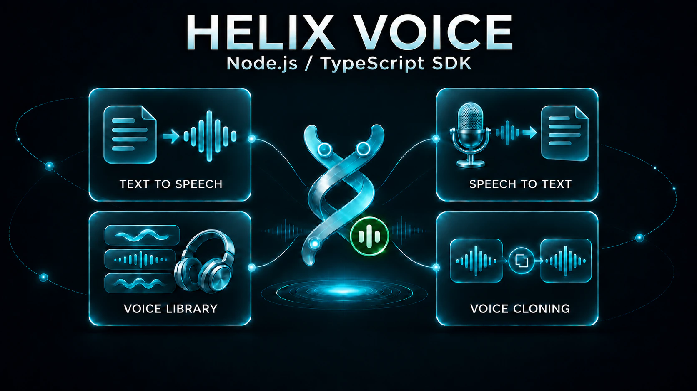

<p align="center">
  
</p>

<h1 align="center">Helix Voice SDK for Node.js and TypeScript</h1>

<p align="center">
  Generate speech, transcribe audio, and manage voices from your Node.js application.
</p>

<p align="center">
  <a href="https://www.npmjs.com/package/@advai-x/helix-voice"></a>
</p>

<p align="center">
  <a href="https://docs.helixvoice.net/">Developer Docs</a> ·
  <a href="examples/">Examples</a> ·
  <a href="https://www.npmjs.com/package/@advai-x/helix-voice?activeTab=versions">Version History</a>
</p>

## Install

Requires Node.js 20 or later. The package includes TypeScript declarations and supports ES module imports and CommonJS.

```sh
npm install @advai-x/helix-voice@0.2.0
```

## Quickstart

Set `HELIXVOICE_API_KEY` to a server-side API key with `voices:read`, `speech:write`, and `generations:read` scopes.

```sh
export HELIXVOICE_API_KEY='YOUR_API_KEY'
```

Save this as `speech.mjs` in your project and run `node speech.mjs`.

```js
import { HelixVoiceClient } from "@advai-x/helix-voice";

const client = new HelixVoiceClient({ baseUrl: process.env.HELIXVOICE_BASE_URL });
const voices = await client.voices.list();
if (voices.length === 0) {
    throw new Error("No voices are available to this account.");
}

const generation = await client.speech.save({
    input: "Hello from Helix Voice.",
    voice: voices[0].id,
    output: "speech.wav",
});

console.log(`Saved speech.wav (generation ${generation.id})`);
```

On success, `speech.wav` is saved in your current directory and the generation ID is printed. See also the [repository example](examples/speech.mjs).

## API keys and account access

For production use, ask your account administrator for a scoped API key and set `HELIXVOICE_API_KEY` in your server environment. The speech example needs `voices:read` to look up a voice, `speech:write` to generate speech, and `generations:read` to download the WAV. Keep the key in server-side secret storage. [API keys and scopes](https://docs.helixvoice.net/en/api/authentication/)

The examples default to `https://api.helixvoice.net`. Set `HELIXVOICE_BASE_URL` when running them against a trusted staging or test API.

## Capabilities and scopes

| Operation | Required scope |
| --- | --- |
| Read service capabilities and limits | `capabilities:read` |
| List public and account-owned voices | `voices:read` |
| Clone or delete an owned voice | `voices:write` |
| Generate speech metadata | `speech:write` |
| Transcribe a Mandarin audio file | `transcriptions:write` |
| List generations or download WAV audio | `generations:read` |
| Delete generation history | `generations:write` |

Voice cloning requires explicit consent. Consult the capabilities response for the limits of your environment. [Developer API reference](https://docs.helixvoice.net/en/api/speech/)

## Troubleshooting

- **401 Unauthorized** means the key is missing, invalid, expired, or revoked. Check the key used by the running process.
- **403 Forbidden** with `insufficient_scope` means the key lacks a required permission. Check the scopes for each request.
- **429 Too Many Requests** means a quota or rate limit was reached. Honor `Retry-After` when available.
- **Speech generated but WAV saving failed** means you can recover the generation ID from the save error and retry the download while that record is retained. Retrying generation can consume quota again.

Keep the request ID when investigating an API error. [Errors and rate limits](https://docs.helixvoice.net/en/api/errors/) · [Generation downloads](https://docs.helixvoice.net/en/api/speech/#history-and-audio)

## License

Licensed under the [Apache License, Version 2.0](LICENSE).
